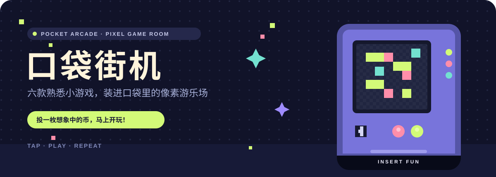

  

  
  
  
  
  

  <strong>一部手机，一座随时开门的小小街机厅。</strong> 
  方块、宝石、小球和像素音效都准备好了——挑一款，玩一会儿吧！🕹️

  <a href="https://github.com/GHOST-AKU/PocketArcade/actions/workflows/android.yml"><strong>⬇️ 获取安卓安装包</strong></a>
  &nbsp;·&nbsp;
  <a href="#六款游戏想玩哪台就玩哪台">看看都有什么</a>
  &nbsp;·&nbsp;
  <a href="#想自己动手">自己构建</a>

---

## 🎮 六款游戏，想玩哪台就玩哪台

| 街机角落 | 开始怎么玩 | 多一点点乐趣 |
| --- | --- | --- |
| 🧱 **俄罗斯方块** | 看准空位，把方块一层层叠起来。 | 想轻松摆一摆？切到解压模式，自选方块、手动落下，还能撤销或清空棋盘。 |
| 💎 **宝石三消** | 交换相邻宝石，让三个或更多同色宝石连在一起。 | 限步、限时、无限三种模式；提示、炸弹、洗牌道具可选。 |
| 🏓 **旋球乒乓** | 拖动球拍，和电脑来一场七分制对决。 | 击球位置和拍子移动会带出旋转，球路也会跟着拐弯。 |
| 💣 **扫雷** | 点开格子，看看数字提示，找出藏起来的雷。 | 想换个难度？棋盘宽高和雷数都能自定义；第一下及周围一圈是安全区。 |
| 🐍 **贪吃蛇** | 滑动转向，吃下苹果，让小蛇慢慢变长。 | 越吃越快，别让它撞上墙或自己的尾巴！ |
| 🧩 **打砖块** | 发球、移动挡板，把弹球送回去。 | 三条命，清掉全部 48 块砖就能通关。 |

## ✨ 这间小街机厅的可爱之处

- **打开就能玩**：六款小游戏都在手机本地运行，不需要账号，也不需要联网。
- **像素味是画出来的**：大厅、图标、点阵和游戏配色由程序绘制，不靠在线素材。
- **声音和触感都能关**：大厅里可以分别开关音效与触感；触感效果会随设备而不同。
- **纪录留在本机**：三消分数、扫雷成绩等保存在本地，切换游戏不会串台。

## ⬇️ 想现在就开玩？

点上面的 **「获取安卓安装包」**，进入 GitHub Actions，打开最新一次成功的 **Build Android APK** 运行，在页面底部的 **Artifacts** 下载 <code>PocketArcade-APK</code>。下载后解压，并在安卓手机上安装其中的 <code>app-debug.apk</code>。

支持 **Android 6.0 及以上**。如果手机提示不允许安装此来源的应用，请在系统设置中允许当前浏览器或文件管理器安装应用。

## 🎵 像素音效从哪里来？

九种芯片音效由仓库里的小脚本合成，没有使用外部采样。音效文件和生成脚本采用 **CC0 1.0**，可以自由复用；游戏其他代码目前没有附加开源许可证。

## 🛠️ 想自己动手？

用 Android Studio 打开项目，或准备 JDK 17、Gradle 8.9 和 Android SDK 35 后运行：

~~~~sh
bash test.sh
gradle assembleDebug
~~~~

规则测试通过后，APK 会生成在 <code>app/build/outputs/apk/debug/app-debug.apk</code>。

---

  不用排队，也没有代币机。祝你今天玩得开心！ 💖

